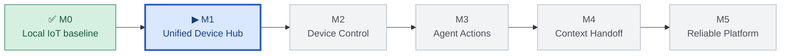

# PWI — Mission Control

> **When you're not sure what to do, open this page.** One active task, a short queue, and links to detailed instructions.  
> Physical World Interface — **Perception · Understanding · Action · Feedback**

**[🏠 Project Home](README.md)** · **[📐 Architecture](docs/architecture/pwi-overview.md)** · **[🧭 Roadmap](docs/roadmap.md)** · **[📋 All Open Issues](https://github.com/cz-33-ai/physical-world-interface/issues?q=is%3Aissue+is%3Aopen)**

---

## 🚪 Two ways to enter PWI

| **Project maintainer — what should I do?** | **New developer — can I try this?** |
|---|---|
| Follow the active task below: [#8 · Sensor freshness and offline behavior](https://github.com/cz-33-ai/physical-world-interface/issues/8) | [5-minute zero-hardware Quick Start](QUICKSTART.md) |
| [Review milestone roadmap](docs/roadmap.md) | [Explore the demo storyboard](docs/demos/prepare-for-sleep.md) |
| [Open implementation issues](https://github.com/cz-33-ai/physical-world-interface/issues?q=is%3Aissue+is%3Aopen) | [How to contribute](CONTRIBUTING.md) |

**Already available:** mock-device "Prepare for Sleep" simulation and six local tests; a standalone **M1 HAOS hub** hosting Mosquitto, Zigbee2MQTT, USB coordinator, two Zigbee sensors, Reolink local preview and partial Midea cloud vacuum controls. **Verified:** HAOS-level reboot restored Apps and both sensor readings; M3 no longer supplies services. **Not yet built/verified:** PWI Gateway, agent-authorized action workflow, offline/freshness acceptance, macOS-host persistence and 24/7 recovery. [Current evidence](docs/05-m1-haos-consolidation-recovery.md).

---

## 🎯 NOW — The single next action

### [#8 — M1.3: Verify state freshness, offline behavior and recovery](https://github.com/cz-33-ai/physical-world-interface/issues/8)

**Why:** On 18 November the lab consolidated the broker, Zigbee2MQTT and coordinator onto M1 HAOS, removed the development Mac's runtime dependency, and demonstrated recovery after a full HAOS system reboot. The largest remaining M1 uncertainty is **freshness/offline behavior and macOS-host resilience**, not whether HA can discover a sensor.

**Exactly what to do next:**

- [x] **Initial setup** — HAOS browser dashboard confirmed using UTM/QEMU and ARM64 HAOS.
- [x] **MQTT Discovery** — Zigbee bridge and two sensors appeared in HA.
- [x] **Live sensor states** — occupancy transition and illuminance verified, temperature/humidity later user-confirmed.
- [ ] **Freshness** — record report timestamps/intervals and verify a controlled sensor change across HA and MQTT within the same observation window.
- [ ] **Offline behavior** — simulate disconnect and distinguish `unavailable` from a valid older reading.
- [x] **HAOS-level recovery** — after a full HAOS system reboot, Mosquitto, Zigbee2MQTT and the two sensor readings returned automatically.
- [x] **M3 independence** — all Zigbee/MQTT services moved to the M1 VM; M3 no longer runs supporting services.
- [x] **Manual backup** — post-migration HAOS backup created (user-confirmed).
- [ ] **Host recovery and off-VM backup** — record evidence for UTM cold restart (not rerun this session), user switching, sleep/host restart, and independently confirm backup download/Emergency Kit storage.

**Acceptance:** Reported value, source, time, observed state change and failure/unknown conditions are distinguishable. Raw evidence belongs in the private lab; only the [sanitized experiment](docs/04-home-assistant-real-device-integration.md) is public.

> **Issue bookkeeping:** **[#6](https://github.com/cz-33-ai/physical-world-interface/issues/6)** (HAOS installation) and **[#7](https://github.com/cz-33-ai/physical-world-interface/issues/7)** (MQTT/Zigbee2MQTT connectivity and Discovery) are **closed** against their original Definitions of done. **[#8](https://github.com/cz-33-ai/physical-world-interface/issues/8)** remains open for sensor freshness/offline tests. Independent macOS/UTM host recovery is tracked in **[#13](https://github.com/cz-33-ai/physical-world-interface/issues/13)**.

---

## ⏭️ NEXT — After the current task

| Order | Task | What you will prove | State |
|:--:|---|---|:--:|
| **1** | **[#8 · Sensor freshness/offline](https://github.com/cz-33-ai/physical-world-interface/issues/8)** | Repeatable readings and distinguishable failures | 🔵 **NOW** |
| **2** | [#2 · ESPHome API vs MQTT](https://github.com/cz-33-ai/physical-world-interface/issues/2) | ESP32-C3 becomes a proper HA entity | ⚪ NEXT |
| **3** | [#3 · Verified actuation](https://github.com/cz-33-ai/physical-world-interface/issues/3) | Request, dispatch, real-world result and failure reporting | ⚪ QUEUED |
| **4** | [#13 · Host reliability & off-VM backup](https://github.com/cz-33-ai/physical-world-interface/issues/13) | Unattended Mac/UTM startup, sleep/USB recovery and independent backup | ⚪ QUEUED |

**M1 parent issue:** [#1 — Unified Device Hub](https://github.com/cz-33-ai/physical-world-interface/issues/1). M1-only connectivity and HAOS reboot recovery passed; exact M1 acceptance still requires offline/freshness evidence and separate host persistence testing.

---

## 🗺️ BIG PICTURE — How far along are we?

| Milestone | Goal | Status | Entry point |
|---|---|---|---|
| **M0 — Baseline** | MQTT, Zigbee, ESP32 communicate locally | ✅ Verified foundation | [Lab tutorials](docs/01-mqtt-broker-and-lan-test.md) |
| **M1 — Device Hub** | Home Assistant sees existing devices | 🔵 **Standalone M1 services + HAOS reboot verified; offline/host reliability pending** | [#1](https://github.com/cz-33-ai/physical-world-interface/issues/1) |
| **M2 — Device Control** | Command an actuator and verify actual feedback | ⚪ Planned | [#3](https://github.com/cz-33-ai/physical-world-interface/issues/3) |
| **M3 — Agent Operation** | “Prepare for Sleep” becomes a controlled workflow | ⚪ Planned | [#4](https://github.com/cz-33-ai/physical-world-interface/issues/4) |
| **M4 — Context Handoff** | Supply physical observations and results upstream | ⚪ Planned | [#5](https://github.com/cz-33-ai/physical-world-interface/issues/5) |
| **M5 — Operations** | Recovery, security, stable repeatability | ⚪ Planned | [Roadmap](docs/roadmap.md) |

Legend: ✅ tested baseline · 🔵 working milestone · ⚪ future work. Statuses here are a curated snapshot, not live-synced GitHub Project fields.

---

## 🌱 COMMUNITY — The next influence-building tasks

These are **not** replacements for the active engineering task. They are release-readiness gates for the public project.

| Goal | Issue | Status |
|---|---|---|
| Get honest feedback from one independent simulator user | [#9 · External reproduction](https://github.com/cz-33-ai/physical-world-interface/issues/9) | Open |
| Adopt Apache-2.0 open-source license | [LICENSE](LICENSE) · [#12](https://github.com/cz-33-ai/physical-world-interface/issues/12) | ✅ Completed |
| Convert the first module into a teachable lesson | [#11 · Course validation](https://github.com/cz-33-ai/physical-world-interface/issues/11) | Open |
| Record actual hardware footage **after a real device works** | [#10 · Physical demo video](https://github.com/cz-33-ai/physical-world-interface/issues/10) | Later |

[Release gates and community strategy](docs/community/launch-plan.md) · [No-hardware Quick Start](QUICKSTART.md)

---

## 🧰 What already works

- ✅ Mosquitto MQTT broker and local publish/subscribe.
- ✅ Zigbee2MQTT motion/illuminance telemetry.
- ✅ ESP32-C3 connected through Wi-Fi/MQTT, including heartbeat and command test.
- ✅ Temperature/humidity values later observed live in HA; reporting timing/freshness still needs a controlled measurement.
- ✅ M1 HAOS services consolidated, MQTT Discovery and two Zigbee sensors verified, HAOS system reboot restored both Apps and telemetry; M3 services retired.
- ✅ Reolink local live camera preview demonstrated.
- 🟡 Midea vacuum cloud device state/control interface partly tested; Locate Robot failed (not a verified action).
- ⬜ macOS-host persistence (sleep/restart/user switch), offline/freshness behavior, ESP32-as-HA-entity, PWI Gateway and agent control **not yet validated**.

Avoid buying more equipment until the next milestone requires it.

---

## 🧩 How to manage work

**One active task at a time.** Detailed commands, acceptance criteria, and results belong in the linked Issue. Larger milestones are parent Issues; a completed task is closed, not deleted.

1. Start at the **NOW** issue, read its checklist and perform one test.
2. Preserve actual commands, outputs and troubleshooting in the **private raw lab notebook**; never add passwords or tokens.
3. Close the Issue only after passing the stated acceptance criteria, with privacy-reviewed evidence.
4. Promote the next queued task to **NOW** here, and update the milestone status.
5. Turn validated experiments into public tutorials and future course lessons.

**Want to see only your active work?** [Open issues assigned to @me](https://github.com/cz-33-ai/physical-world-interface/issues?q=is%3Aissue+is%3Aopen+assignee%3A%40me).

**Want the first demo?** [Try the offline Quick Start](QUICKSTART.md) · [Flagship real-device requirements](docs/demos/prepare-for-sleep.md).  
**Need architectural context?** [PWI architecture](docs/architecture/pwi-overview.md).  
**Need the broader plan?** [Roadmap](docs/roadmap.md).  
**Need a practical experiment?** [MQTT](docs/01-mqtt-broker-and-lan-test.md) · [ESP32](docs/02-esp32c3-esphome-mqtt.md) · [Zigbee](docs/03-zigbee2mqtt-sensor-observations.md) · [M1 HAOS consolidation](docs/05-m1-haos-consolidation-recovery.md).

---

**Maintenance note:** After a milestone closes, update the NOW/NEXT section and diagram in the same documentation change. For live task status, open the linked GitHub Issue.
