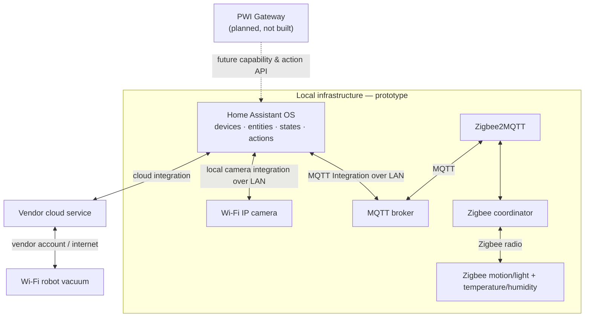

# Experiment 04 — Home Assistant unified device hub (real-device validation)

> **Historical baseline:** This report describes the initial **cross-Mac** HA device-hub experiment. Since 18 November, Mosquitto, Zigbee2MQTT and the coordinator have moved into the M1 HAOS deployment; **HAOS-level reboot recovery was verified**. See **[Experiment 05 — M1 HAOS consolidation](05-m1-haos-consolidation-recovery.md)** for the current architecture and updated acceptance boundaries. The descriptions below retain the original experiment's status as-of its initial run.

**Updated:** 18 November 2026 (SGT)  
**Scope:** Sanitized report from a private home IoT laboratory. **Real Home Assistant hardware integration is demonstrated; PWI Gateway/agent control is not.**

This document continues [Experiment 01 — MQTT](01-mqtt-broker-and-lan-test.md), [Experiment 02 — ESP32-C3](02-esp32c3-esphome-mqtt.md), and [Experiment 03 — Zigbee2MQTT](03-zigbee2mqtt-sensor-observations.md).

## Result at a glance

| Capability | Observed evidence | Status |
|---|---|---|
| Home Assistant OS virtual machine | ARM64 HAOS 18.3 booted and dashboard opened in browser on an Apple Silicon Mac using UTM/QEMU | **Verified initial boot** |
| Zigbee integration | MQTT Integration + Zigbee2MQTT Discovery showed motion/light and temperature/humidity devices | **Verified** |
| Motion and illuminance | Binary occupancy changed from clear to detected; illuminance reported live | **Verified** |
| Temperature and humidity | Initially unknown after discovery, later user confirmed live HA values | **Verified**, timing not characterized |
| IP camera | Reolink local integration exposed live video; dashboard Picture Entity Live playback reduced earlier multi-second lag to almost no perceived lag | **Verified local preview** |
| Robot vacuum | Midea Auto Cloud integration exposed a docked robot, battery and other attributes; control interface tested | **Partially verified**; some commands unsupported/failed |
| PWI Gateway / agent semantic action interface | No connected implementation yet | **Not implemented** |
| Always-on reliability | Shared laptop VM not yet tested across restart, user switching or sleep | **Pending** |

## Transport architecture



### What this proves

- **Wi-Fi is not MQTT.** Wi-Fi provides an IP link; software above it may use local device APIs, MQTT or a vendor cloud. Zigbee sensors use a different radio network and need a coordinator/bridge.
- **Home Assistant unifies heterogeneous hardware** as devices, entities, observed states and control actions regardless of the downstream protocol.
- **Device discovery is not proof of fresh telemetry.** Initially the temperature/humidity entities existed but their values were `Unknown`; later readings appeared. Track freshness, availability and timestamps separately.
- **An action appearing in an HA UI is not proof of execution.** One robot-vacuum locate command produced a send failure. A supported-looking control is not yet a verified physical capability.
- **Local preview and cloud control have different failure modes.** Camera streaming worked locally; the vacuum integration relies on the manufacturer's cloud service.

## Reproducible Home Assistant path (sanitized)

1. Install a compatible **ARM64 HAOS** virtual disk into a virtualization engine on Apple Silicon. The lab used **UTM/QEMU**, an imported ARM64 QCOW2 image, two virtual CPUs and 2 GiB of RAM. The exact compatibility of HAOS versions and host hypervisors should be checked before repeating.
2. Give the VM working LAN access and open the HA web UI. A Wi-Fi bridge can work, but is not guaranteed on every macOS/hypervisor/router combination.
3. Add HA's built-in **MQTT Integration** and point the Broker field to `<MQTT_BROKER_LAN_IP>` with port `1883` (or a securely configured alternate port). The broker needs a LAN listener and proper access controls. Do not expose it to the Internet.
4. Keep Zigbee2MQTT attached to the single Zigbee coordinator; enable HA discovery in the Zigbee2MQTT configuration:
   ```yaml
   homeassistant:
     enabled: true
   ```
5. Check that sensor devices/entities appear in HA; then induce and observe a sensor change. An initial `Unknown` reading is not automatically a defect.
6. Add a **supported local camera integration** and a **Picture Entity** card with the actual camera entity and `Camera view: Live`. A plain Picture card displays static/media content and is not interchangeable with a live-camera card.
7. For cloud-only devices, label their capabilities and operational dependencies explicitly; test one harmless command and verify the real-world outcome. Do not equate an integration's available controls with tested functionality.
8. Create a custom dashboard to group **camera, sensors and actuators**. This is a useful human-facing lab UI, not the PWI Gateway interface.

No real household IPs, SSIDs, hardware addresses, camera frames, credentials, serials, Zigbee keys or backup decryption keys appear in this document.

## What remains to be done

- **M1 reliability:** verify state freshness, offline/disconnected behavior, cold restart, recovery and backup restoration. The initial boot/dashboard success is not a production uptime claim.
- **Actuation:** distinguish control invocation from confirmed physical action and failure; build a repeatable feedback test with a safe device and explicit authorization boundary.
- **ESP32-C3:** previous Wi-Fi/MQTT firmware tests are not equivalent to an ESPHome/HA entity integration. Compare native ESPHome API with MQTT for the PWI lab.
- **Deployment:** remove dependency on a foreground development laptop for MQTT and Zigbee2MQTT. Preserve the Zigbee network identity and coordinate a controlled service migration.
- **PWI Gateway:** expose only normalized device capabilities, state query, action authorization, dispatch results and verification evidence. Keep Personal Agent planning and Personal Context memory outside the gateway.
- **Robot mapping:** cleaned area in square meters is **not** a saved floorplan. The tested vacuum's mapping persistence and editable rooms have not been verified.

## Glossary

| Term | Definition |
|---|---|
| HA / HAOS | Home Assistant / Home Assistant Operating System |
| MQTT | Message Queuing Telemetry Transport |
| Zigbee2MQTT | Zigbee network bridge publishing messages via MQTT |
| MQTT Discovery | Mechanism by which software advertises HA device/entity definitions over MQTT |
| QEMU | Emulator/virtualizer powering the chosen development VM |
| ARM64 | 64-bit ARM processor architecture |
| IP / LAN | Internet Protocol / Local Area Network |
| RTSP | Real Time Streaming Protocol |
| WebRTC | Web Real-Time Communication |
| HLS | HTTP Live Streaming |
| PTZ | Pan/Tilt/Zoom |
| PWI | Physical World Interface |

> **Evidence discipline:** The private lab journal contains actual commands and observed screen states. The public project intentionally publishes only a reproducible and privacy-reviewed synthesis. Future screenshots, logs and tutorials must be sanitized before release.
