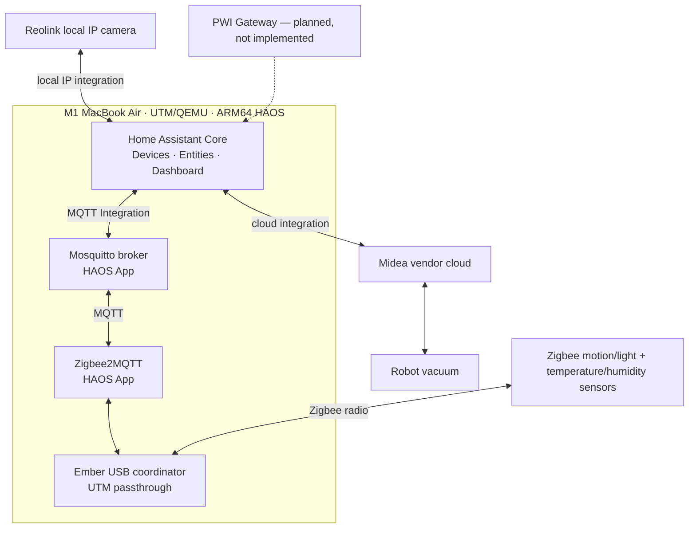

# Experiment 05 — Consolidated M1 Home Assistant device hub and recovery test

**Date:** 18 November 2026 (SGT)  
**Status:** Real-device consolidation and HAOS-level reboot recovery **verified**. Host-level availability, offline/freshness semantics, and PWI Gateway remain unverified/not implemented.  
**Previous baseline:** [Experiment 04 — Initial Home Assistant device integration](04-home-assistant-real-device-integration.md).

## What changed

The initial experiment placed **Home Assistant OS on an M1 Mac** while **MQTT broker, Zigbee2MQTT and the Zigbee radio remained on an M3 development Mac**. This was useful for discovery and UI verification, but the M1 could not sustain fresh Zigbee telemetry without the M3.

On 18 November the services and USB radio were moved to the **same M1 HAOS VM**. The development Mac now supplies no running service to this lab (user-confirmed). The original Zigbee network was restored without re-pairing.

| Capability | Before | After |
|---|---|---|
| Home Assistant UI | M1 HAOS VM | M1 HAOS VM |
| MQTT broker | Separate M3 host | Mosquitto HAOS App on M1 |
| Zigbee2MQTT | Separate M3 host | Zigbee2MQTT HAOS App on M1 |
| Zigbee coordinator | USB attached to M3 | USB passed through to M1 HAOS VM |
| Sensor discovery and values | Cross-host MQTT path | Internal broker + HA MQTT Integration |
| Restart evidence | Initial boot only | Full **HAOS system reboot** recovered Apps and both Zigbee sensors |
| Backup | Earlier VM snapshot/backup | Post-migration manual HAOS backup user-confirmed |
| M3 runtime dependency | Yes | **No** |

## Architecture after migration



**Protocol clarification:** Zigbee sensors communicate through Zigbee radio; MQTT transports gateway messages and Discovery inside the HAOS environment. The local camera does not require MQTT, and robot-vacuum integration still depends on its cloud service. 'Standalone M1' describes consolidation **relative to the M3 computer**, not internet independence or 24/7 availability.

## Migration procedure (sanitized)

1. Archive Zigbee2MQTT's original pairing/network data and preserve the existing coordinator identity. Keep secrets, network keys and raw backups off Git.
2. On HAOS, install the official Mosquitto and Zigbee2MQTT Apps. Create a dedicated MQTT login with least-privilege settings appropriate to the deployment.
3. Stop the old Zigbee2MQTT process before moving its single USB coordinator. Attach the coordinator to the M1 and pass it into the HAOS virtual machine using the hypervisor USB-device feature.
4. Transfer the original Zigbee2MQTT data through a temporary file-share mechanism; restore the prior network identity and pairing database without re-pairing.
5. Configure the HAOS Zigbee2MQTT App for the internal broker, Ember adapter and the **actual HAOS serial device**. A representative, non-secret subset:

   ```yaml
   mqtt:
     server: mqtt://core-mosquitto:1883
     user: <MQTT_USER>
     password: <SECRET_NOT_COMMITTED>
   serial:
     port: /dev/ttyACM0  # example: inspect actual system hardware
     adapter: ember
     baudrate: 115200
   homeassistant:
     enabled: true
   ```

6. Reconfigure HA's **MQTT Integration** to the new broker. A Zigbee2MQTT Discovery publish in its own Logs does **not** prove HA subscribed to the same broker.
7. Enable app start-on-boot/watchdog, perform a full HAOS operating-system reboot, and confirm broker, Zigbee2MQTT and actual sensor readings return.

**Operational lesson:** USB serial availability through a hypervisor can be intermittent; failure to open the serial path is not a reason to reset Zigbee networking or clear the device database. A YAML parse error and credential-editing issue were also corrected during this migration. The precise intermittent USB failure cause was not proven.

## Evidence and acceptance boundaries

| Verification | Result |
|---|---|
| Zigbee2MQTT Discovery reaches HA's MQTT Integration on new broker | **Passed** |
| Motion/illuminance sensor and temperature/humidity sensor display live states | **Passed** |
| M3 processes no longer required | **Passed** |
| HAOS **system reboot**: Mosquitto, Zigbee2MQTT and sensor telemetry recover automatically | **Passed** |
| Manual post-migration HAOS backup created | **User confirmed** |
| Backup download off VM and encryption Emergency Kit separately verified | **Not confirmed** |
| UTM cold start in this session | **Not run** (user indicated prior exercise) |
| macOS restart / sleep / user-switch unattended recovery | **Not verified** |
| MQTT-vs-HA timestamp/freshness and offline/unavailable semantics | **Not verified** |
| PWI Gateway and Agent-driven real-world action | **Not implemented** |

The dashboard also retains the previously validated **Reolink local live camera preview** and partially verified **Midea cloud robot-vacuum state/control**. A failed vacuum Locate command and unverified robot mapping remain open; do not conflate displayed controls with successful actuation.

## Next measurable tests

1. Log an intentional motion/light change with message and HA timestamps; define freshness and stale-state reporting.
2. Disconnect one safe upstream link, observe the actual HA `unavailable` / restored behavior, and document recovery.
3. Establish off-VM backup and separate recovery-key storage and an unattended host/VM recovery policy.
4. Bring an ESP32-C3 into HA as a real entity; compare ESPHome Native API with MQTT.
5. Build one authorized, state-verified physical action before implementing a PWI Gateway action endpoint.

See [Mission Control](../START_HERE.md), [roadmap](roadmap.md) and [#8 — sensor freshness/offline acceptance](https://github.com/cz-33-ai/physical-world-interface/issues/8).

> **Privacy:** This public report deliberately excludes household IPs, actual device addresses/serials, usernames, passwords, screenshots of private camera footage, Zigbee keys and backup contents. Exact operational failures and local paths belong in the private lab journal.
